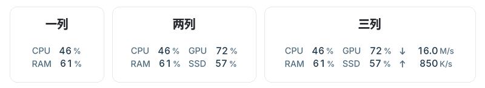

  

<h1 align="center">Peek</h1>

<strong>把常看的电脑读数放在任务栏</strong>

  不用切窗口，就能看 CPU、GPU、内存、网速和磁盘。 
  两行排列，支持一至三列和分页。无需安装 AsterHub。

  
  
  
  

## 小组件特性

### 两行排列，最多三列

只想看 CPU 和内存，可以用一列；也可以排满三列，同时看六个指标。名称、指标和位置都能调整。

  

### 空间不足时自动收缩

先缩小列间距，再从右侧逐列退出；空间腾出来后恢复原排列。

  

### 多页切换，按用途分组

最多三页。比如第一页看利用率，第二页看网速和磁盘读写，第三页看显卡温度、频率和功耗。把鼠标移到小组件上用滚轮换页，也可以开启定时切页。

  

### 读数和小图可以搭配

数字适合看当前值，折线适合看短期变化。部分指标还支持柱状图或环形图；一列或两列时，数字和小图可以放在同一个指标里；名称、读数和图形的颜色可以分别调整。

  

还可以设置网速单位、隐藏部分单位或百分号、调整刷新间隔。需要时可开启「点击打开资源详情」。可采集的指标取决于硬件与驱动。

## 下载安装

| 版本 | 如何使用 |
| --- | --- |
| [Windows 安装版](https://github.com/1159112519/Peek/releases/download/v0.1.0/Peek-Setup-v0.1.0.exe) | 推荐日常使用。运行安装向导，再从开始菜单打开 Peek。 |
| [Windows 便携版](https://github.com/1159112519/Peek/releases/latest/download/Peek.exe) | 下载后直接运行，无需解压。 |
| [SHA-256 校验文件](https://github.com/1159112519/Peek/releases/latest/download/SHA256SUMS.txt) | 核对下载文件的完整性。 |

首次运行后，可从通知区的 Peek 图标打开设置。在「任务栏」选好指标和排版，点击「应用」。需要登录 Windows 后自动运行时，可在「常规」开启静默启动。

**系统要求：** Windows 10 1809 或更新版本（64 位）、.NET Framework 4.7.2 或更新版本，以及 Microsoft Edge WebView2 Runtime。安装向导会检查 WebView2。

各版本的改进见[更新记录](CHANGELOG.md)与 [GitHub Releases](https://github.com/1159112519/Peek/releases)。

## 开发与许可

源码位于 [`desktop/`](desktop/)。本地构建见[开发指南](docs/BUILDING.md)，随附依赖及许可见[第三方组件说明](docs/THIRD-PARTY.md)。项目源码公开浏览，尚未授予通用开源许可。
