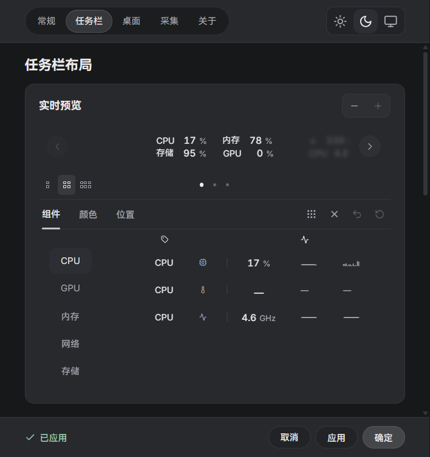
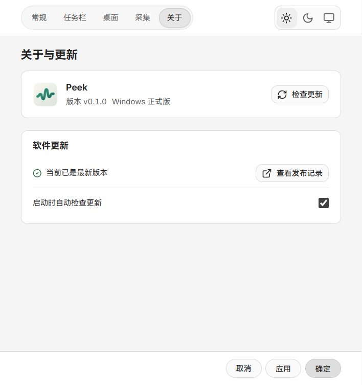

  

<h1 align="center">Peek</h1>

<strong>把常看的电脑读数放在任务栏</strong>

  不用切窗口，就能看 CPU、GPU、内存、网速和存储。 
  也可以在桌面上单独显示。无需安装 AsterHub。

  
  
  
  

   
  Peek v0.1.0 · 任务栏布局与实时预览

## 主要功能

### 在任务栏看实时读数

从 CPU、GPU、内存、网络、存储里挑选常看的指标，拖到实时预览中排列。指标多时可以分页，按自己的习惯调整显示样式和刷新间隔。

### 把监测放到桌面

桌面监测可以独立开启。用带圆角背景的悬浮条显示所选读数，不占任务栏位置；显示内容和颜色可以单独设置。

### 调整外观与启动方式

设置界面可用右上角的图标切换浅色、深色或跟随系统。应用图标可以单独更换，不随明暗切换。在「常规」启用登录 Windows 时静默启动，登录后不弹设置窗口。

### 在应用内检查更新

在「关于」手动检查，或启用启动时自动检查。发现新版后可打开官方发布页，自行下载和安装，不会静默安装更新。

  

## 下载安装

| 版本 | 如何使用 |
| --- | --- |
| [Windows 安装版](https://github.com/1159112519/Peek/releases/download/v0.1.0/Peek-Setup-v0.1.0.exe) | 推荐日常使用。运行安装向导，再从开始菜单打开 Peek。 |
| [Windows 便携版](https://github.com/1159112519/Peek/releases/latest/download/Peek.exe) | 下载后直接运行，无需解压。 |
| [SHA-256 校验文件](https://github.com/1159112519/Peek/releases/latest/download/SHA256SUMS.txt) | 核对下载文件的完整性。 |

首次运行后，可从通知区的 Peek 图标重新打开设置。到「任务栏」或「桌面」配置要显示的读数，然后点击「应用」。可采集指标取决于硬件与驱动。

**系统要求：** Windows 10 1809 或更新版本（64 位）、.NET Framework 4.7.2 或更新版本，以及 Microsoft Edge WebView2 Runtime。安装向导会检查 WebView2。

**已经安装？** 打开「关于 → 检查更新」。各版本的改进见[更新记录](CHANGELOG.md)与 [GitHub Releases](https://github.com/1159112519/Peek/releases)。

## 开发与许可

源码位于 [`desktop/`](desktop/)。本地构建见[开发指南](docs/BUILDING.md)，随附依赖及许可见[第三方组件说明](docs/THIRD-PARTY.md)。项目源码公开浏览，尚未授予通用开源许可。
